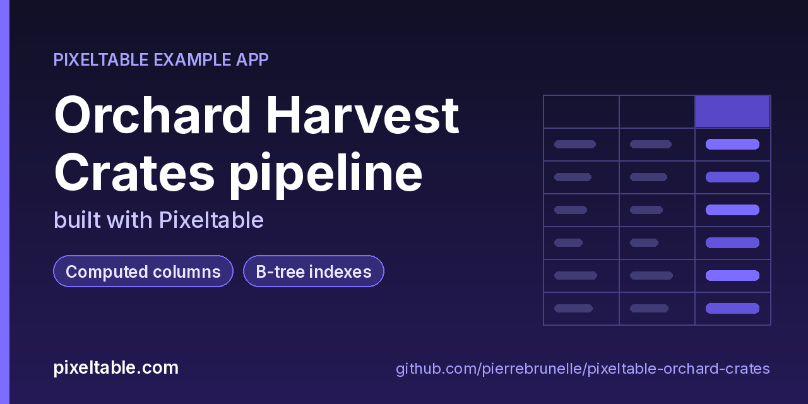

<!-- pixeltable-example-app: 20261012-orchard-crates -->
# Orchard Harvest Crates pipeline built with Pixeltable



[](https://codespaces.new/pierrebrunelle/pixeltable-orchard-crates?quickstart=1)
[](https://pixeltable.com)
[](https://pypi.org/project/pixeltable/)
[](https://github.com/pixeltable/pixeltable)
[](LICENSE)

A notebook-style batch ETL for orchard harvest crates. Rows land from CSV via import_csv into a staging table, then into a modeled crates table with packing math from pixeltable.functions.math (abs, ceil, floor, round, sqrt, log, pow) and moisture validation via an on_error=ignore UDF. Schema evolution drops a temporary ingest_batch column and adds density_pow plus shelf_life_days. Drive it with `python run.py` — no HTTP router.

[Pixeltable](https://pixeltable.com) is open-source, Python-native **multimodal AI data infrastructure**: tables, incremental computed columns, UDFs, indexes and serving in one library, running locally or on Pixeltable Cloud.

> ⭐ **Like this example?** Star [pixeltable/pixeltable](https://github.com/pixeltable/pixeltable) on GitHub. It helps other developers find it.

## What this example shows

- **Incremental computed columns** powered by plain Python UDFs (`@pxt.udf`)
- **B-tree indexes** declared on the model (`__indexes__`) back the lookup queries
- **Importable UDF module**: UDFs live in `udfs.py`; tables and queries live in `app.py` (Pixeltable resolves UDFs by module path)
- **`pixeltable.toml`** declares a local database and a **Pixeltable Cloud** database, so the same code deploys with `pxt db update`

## CSV round-trip

`import_csv` loads `data/crates.csv` into a staging table; `export_csv` writes an enriched view after computed columns land.

## Packing math

`abs` / `ceil` / `floor` / `round` / `sqrt` / `log` / `pow` derive volume, density, and shelf-life hints.

## on_error=ignore

`moisture_ok` raises on out-of-range moisture; inserts use `on_error='ignore'` so bad rows keep `errortype`/`errormsg`.

## Schema evolution

Stage-1 schema includes `ingest_batch`; final `app.py` drops it (`--allow-destructive`) and adds `density_pow` + `shelf_life_days`.

## What's inside

| File | What it is |
|------|------------|
| `.devcontainer/devcontainer.json` | GitHub Codespaces / Dev Container config: Python 3.12, installs `requirements.txt` |
| `.github/social-preview.png` | Social preview image (1280x640) |
| `CITATION.cff` | Citation metadata (authors, license, release date, keywords) |
| `app.py` | Tables declared as Python classes and `@pxt.query` functions |
| `data/crates.csv` | Sample data |
| `data/crates_enriched.csv` | Sample data |
| `pixeltable.toml` | Project config: the local database plus a Pixeltable Cloud database (sizing, deploy excludes) |
| `run.py` | Orchard Crates batch-etl driver (no HTTP service) |
| `schema_stage1.py` | Stage-1 schema for orchard crates (pre-evolution). Applied by run.py before the final app.py |
| `udfs.py` | Pixeltable UDFs (`@pxt.udf`) in their own importable module, imported by `app.py` |
| `requirements.txt` / `pyproject.toml` | Dependencies (`pixeltable>=0.7.16`) |

**Tables**

| Table | Stored columns | Computed columns |
|-------|---------|------------------|
| `crates` | `crate_code`, `orchard`, `variety`, `weight_kg`, `length_cm`, `width_cm`, `height_cm`, `moisture_pct` | `crate_id`, `abs_weight`, `weight_ceil`, `weight_floor`, `weight_rounded`, `side_sqrt`, `volume_log`, `density_pow`, `shelf_life_days`, `moisture_checked`, `lane`, `tag` |
| `crates` | `crate_code`, `orchard`, `variety`, `weight_kg`, `length_cm`, `width_cm`, `height_cm`, `moisture_pct`, `ingest_batch` | `crate_id`, `abs_weight`, `weight_ceil`, `weight_floor`, `weight_rounded`, `side_sqrt`, `volume_log`, `moisture_checked`, `lane`, `tag` |

## Run in your browser (GitHub Codespaces)

[](https://codespaces.new/pierrebrunelle/pixeltable-orchard-crates?quickstart=1)

1. Click **Open in GitHub Codespaces** above (or [this link](https://codespaces.new/pierrebrunelle/pixeltable-orchard-crates?quickstart=1)). The dev container installs Python 3.12 and `pixeltable>=0.7.16` from `requirements.txt`.
2. In the codespace terminal, create the tables, seed them and run the app:

   ```bash
   pxt schema update app.py orchard
   pxt schema update schema_stage1.py orchard
   python run.py
   ```


## Quickstart

Requires Python 3.11+ and `pixeltable>=0.7.16`.

```bash
git clone https://github.com/pierrebrunelle/pixeltable-orchard-crates.git
cd pixeltable-orchard-crates
python -m venv .venv && source .venv/bin/activate
pip install -r requirements.txt

# Create the tables in a local catalog directory named `orchard`
pxt schema update app.py orchard

pxt schema update schema_stage1.py orchard
python run.py
```

## Deploy to Pixeltable Cloud

The same `app.py` runs on [Pixeltable Cloud](https://pixeltable.com). Sign in (or get a free trial database with `pxt new`), point the second database entry in `pixeltable.toml` at your own database, then deploy:

```bash
pxt login                       # or: export PIXELTABLE_API_KEY=<your-api-key>
# edit pixeltable.toml: name = 'pxt://<your-org>:<your-db>'
pxt db update pxt://<your-org>:<your-db>                 # build the image and upload the project
pxt schema update app.py pxt://<your-org>:<your-db>/orchard   # create the tables in the hosted database
```

Keep keys in environment variables or `pxt secret set`, never in code.

## Code walkthrough

**1. Business logic is plain Python, in `udfs.py`.** A `@pxt.udf` function can be used as a column expression. Pixeltable records UDFs by module path (`udfs.grade_lane`), so they live in their own importable module rather than inline in the app: the daemon, serving workers and Pixeltable Cloud import it again by that path.

```python
# udfs.py
@pxt.udf
def grade_lane(variety: str, weight_kg: float) -> str:
    """Map variety + weight into a packing lane label."""
    v = (variety or 'unknown').strip().lower().replace(' ', '-')
    w = float(weight_kg) if weight_kg is not None else 0.0
    if w <= 0:
        bucket = 'reject'
    elif w < 16:
        bucket = 'light'
    elif w < 20:
        bucket = 'mid'
    else:
        bucket = 'heavy'
    return f'{v}:{bucket}'
```

**2. Tables are Python classes (`app.py`).** Annotated attributes are stored columns; attributes assigned an expression are **computed columns** (`crate_id`, `abs_weight`, `weight_ceil`, `weight_floor`, `weight_rounded`, `side_sqrt`, `volume_log`, `density_pow`, `shelf_life_days`, `moisture_checked`, `lane`, `tag`), evaluated incrementally on every insert or update and recomputed when their inputs change. Indexes live next to the columns.

```python
# app.py
class Crates(TableModel, name='crates', has_default_idxs=False):
    """One orchard harvest crate with packing math and moisture validation."""

    crate_id = pxt.Column(value=pxtf.uuid.uuid7(), primary_key=True)
    crate_code: pxt.String
    orchard: pxt.String
    variety: pxt.String
    weight_kg: pxt.Float
    length_cm: pxt.Float
    width_cm: pxt.Float
    height_cm: pxt.Float
    moisture_pct: pxt.Float

    # --- fn.math primary helpers ---
    volume_cm3 = length_cm * width_cm * height_cm
    abs_weight = pxtm.abs(weight_kg)
    weight_ceil = pxtm.ceil(weight_kg)
    weight_floor = pxtm.floor(weight_kg)
    weight_rounded = pxtm.round(weight_kg, 1)
    side_sqrt = pxtm.sqrt(pxtm.abs(length_cm))
    volume_log = pxtm.log(pxtm.abs(volume_cm3) + 1.0)
    density = weight_kg / (volume_cm3 / 1000.0)  # kg / liter
    density_pow = pxtm.pow(pxtm.abs(density) + 0.01, 0.5)  # added in schema evolution
    shelf_life_days = pxtm.floor(30.0 - pxtm.abs(moisture_pct - 12.0))  # evolution add

    # --- on_error UDF path ---
    moisture_checked = moisture_ok(moisture_pct)
    lane = grade_lane(variety, weight_kg)
    tag = crate_tag(crate_code, orchard)

    __indexes__ = [
        pxt.BtreeIndex(orchard),
        pxt.BtreeIndex(variety),
        pxt.BtreeIndex(lane),
    ]
```

**3. Queries are functions (`app.py`).** `@pxt.query` wraps a Pixeltable query so it can be called from Python or exposed as a route:

```python
# app.py
@pxt.query
def by_orchard(orchard: str):
    """Crates for one orchard (orchard index)."""
    return (
        Crates.where(Crates.orchard == orchard)
        .select(
            Crates.crate_code,
            Crates.variety,
            Crates.weight_kg,
            Crates.density,
            Crates.lane,
            Crates.tag,
            Crates.shelf_life_days,
        )
        .order_by(Crates.crate_code)
    )
```

## Learn more

- 🌐 Website: https://pixeltable.com
- 📚 Docs: https://docs.pixeltable.com
- 💻 Source: https://github.com/pixeltable/pixeltable (⭐ star it if Pixeltable is useful to you)
- 📦 PyPI: https://pypi.org/project/pixeltable/
- 🧩 More example apps: https://pierrebrunelle.github.io/awesome-pixeltable-apps/

**[More Pixeltable example apps →](https://pierrebrunelle.github.io/awesome-pixeltable-apps/)**

---

<sub>Built as part of a daily series of Pixeltable example apps · Pixeltable 0.7.16 · Python, incremental computed columns · Licensed under Apache-2.0.</sub>
